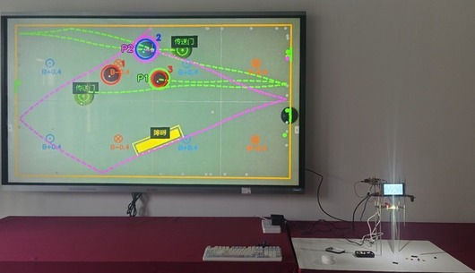
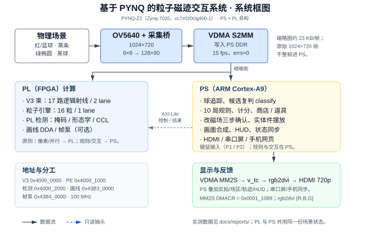
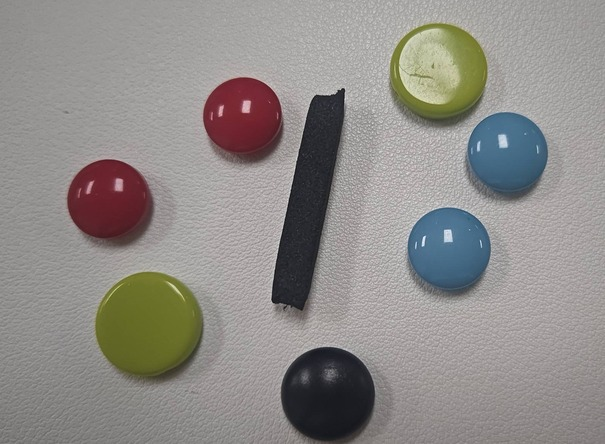
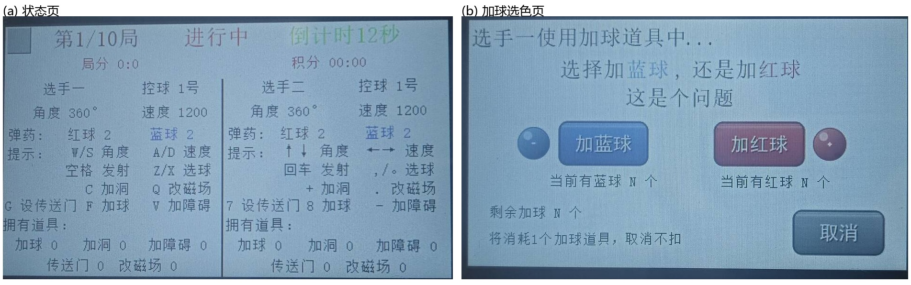
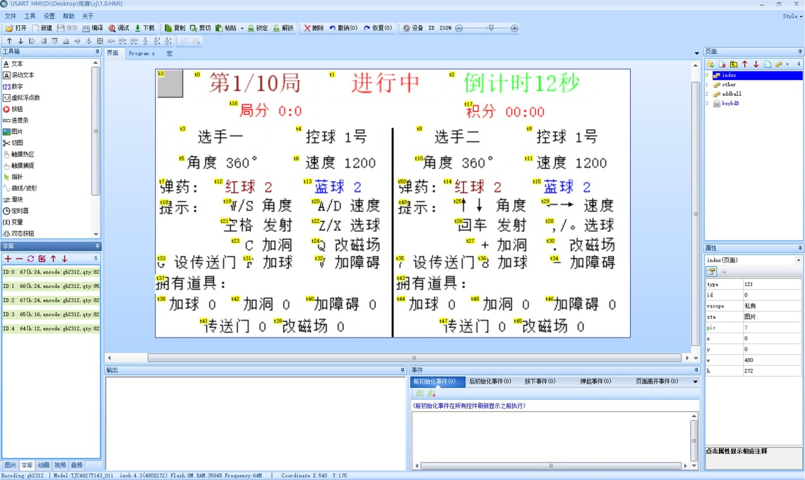
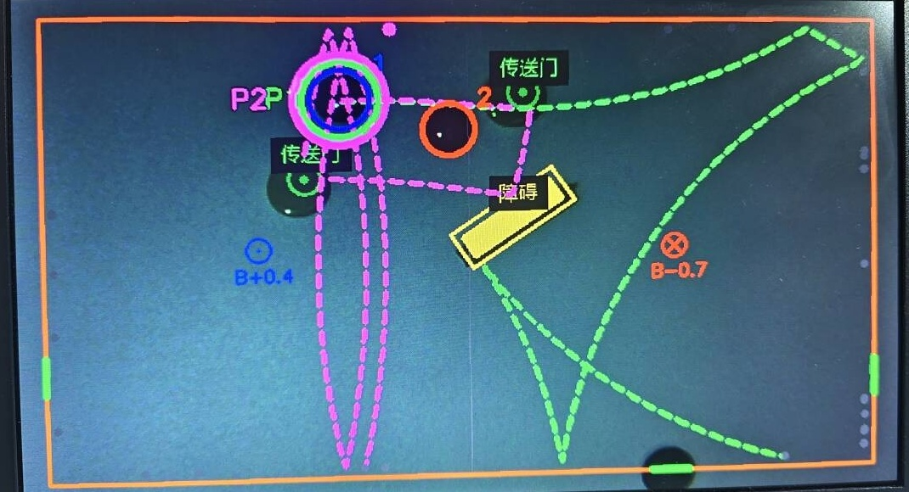
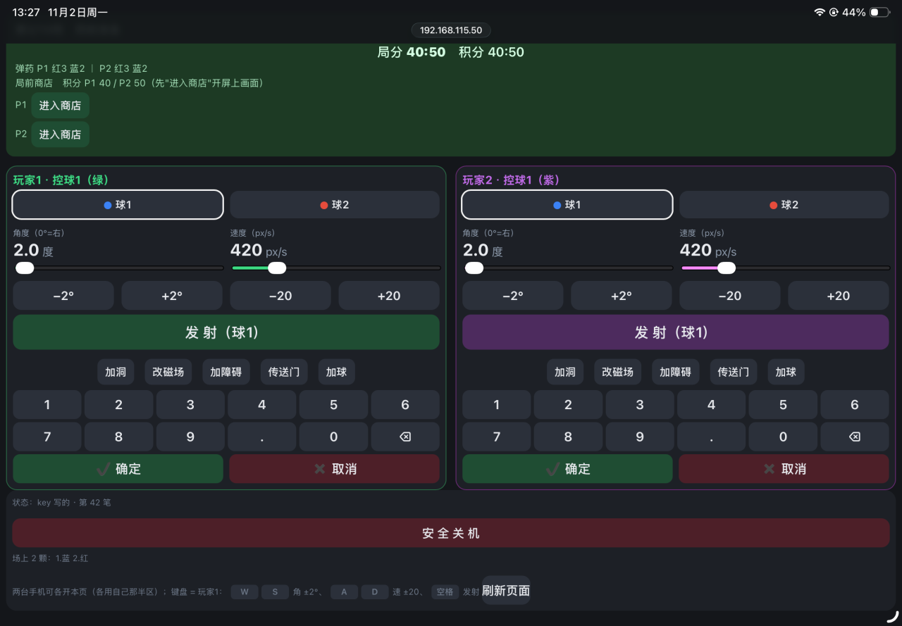
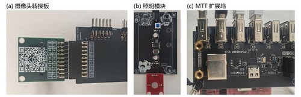

# 基于PYNQ的粒子磁迹交互系统

设计报告

参赛赛道：全国大学生嵌入式芯片与系统设计竞赛2026 · AMD赛道 · 自主选题（初级组）
目标平台：PYNQ-Z2 / AMD Xilinx Zynq-7020（xc7z020clg400-1）
开发工具：Vivado 2023.2（基线）/ 2026.1（迁移验证，见5.2）

2026年11月

[[SEC_SUMMARY]]

## 摘要

针对磁场教学中带电粒子运动难以直观演示、多路轨迹串行计算实时性不足的问题，本文设计并实现了一套基于PYNQ-Z2的粒子磁迹交互系统。系统以实体球为输入，通过OV5640相机与FPGA视觉前端提取球的位置和速度，将其映射为虚拟场区中的带电粒子；玩家可调节入射角度、速度与分块磁场，并通过HDMI、串口屏和移动端网页实时观察粒子偏转、碰撞与出射过程。

系统采用PS/PL异构架构：PL实现17路轨迹束（2条物理lane时间复用）、16粒并行粒子引擎、像素级候选检测以及障碍/传送门/洞口判定；PS负责对局规则、候选复判、画面合成与多端交互。实验结果表明，同一簇17路轨迹的求解时间由PS串行的534 ms降至PL的约24 ms，加速约22倍；16粒粒子引擎在2000个子步上与软件黄金模型逐位一致，板上探针P1–P6全部通过；V3轨迹束17/17逐位一致，PL检测同帧8/8，板级台架488/488。系统在PYNQ-Z2上完成全量构建与时序收敛，WNS +0.094 ns、WHS +0.013 ns，LUT占用79.60%。

相机链路为15 fps；实拍叠加预览按帧更新（约2.8~3.0 fps），物理计算本身为毫秒级，二者口径不同。系统已用于课堂演示与双人对战场景。

说明：对外提交的项目简介中“集成8粒PL粒子引擎”为早期口径；现役RTL与交付bit均为16粒（NPART=16），板上P1–P6已验证，以本报告为准。

关键词：PYNQ；FPGA；粒子物理；硬件并行；机器视觉

## Abstract

To address the difficulty of intuitively demonstrating charged-particle motion in magnetism education and the limited real-time performance of serial multi-ray computation, this paper presents a particle magnetic-trace interactive system built on a PYNQ-Z2 platform. A physical ball is observed by an OV5640 camera; an FPGA vision front-end extracts its position and velocity and maps them into a virtual field. Players adjust the launch angle, speed, and block magnetic field, and observe particle deflection, collision, and exit through HDMI, a serial display, and a mobile web page.

The system adopts a PS/PL heterogeneous architecture. The PL implements a 17-ray trajectory bundle with two time-multiplexed physical lanes, a 16-particle parallel physics engine, pixel-level candidate detection, and obstacle/portal/hole decisions. The PS handles match rules, candidate re-checking, rendering, and multi-terminal interaction. Experimental results show that one 17-ray bundle is solved in about 24 ms on the PL versus 534 ms in the PS serial reference, a speedup of about 22x. The 16-particle engine matches the software golden model bit-exactly over 2000 substeps, and on-board probes P1-P6 all pass. The V3 bundle is 17/17 bit-exact, PL detection is 8/8 on the same frame, and the board-level bench passes 488/488. The design is fully built and timing-closed on the PYNQ-Z2, with WNS +0.094 ns, WHS +0.013 ns, and 79.60% LUT utilization.

The camera link runs at 15 fps; the live overlaid preview updates at about 2.8-3.0 fps, while the physics computation itself is in the millisecond range. The system has been used in classroom demonstrations and two-player matches.

Note: the submitted project brief predates the final particle-engine specification; its “8-particle” wording is outdated. The current RTL and delivered bit use 16 particles (NPART=16), verified on board by probes P1-P6; this report takes precedence.

Keywords: PYNQ; FPGA; particle physics; hardware parallelism; machine vision

## 目录

[[TOC]]

[[SEC_BODY]]

## 1 作品概述

### 1.1 要解决的问题

电磁学教学中的一个典型问题是：粒子进入磁场后做圆周运动，半径和转向可由公式计算，但学生面对“入射角度偏2度后粒子从哪边出去”这类问题时，往往难以准确判断。软件仿真（PhET、GeoGebra）可以拖动参数，但交互仍停留在参数层面，缺少亲手摆放障碍、观察粒子绕行过程的直接体验；同时计算十几条微扰轨迹时，CPU串行会导致画面明显卡顿。

我们想把物理搬到FPGA上：桌上放实体球，摄像头俯拍，球的位置和速度实时映射到虚拟场区。17路轨迹之间没有依赖，16颗粒子之间也没有依赖，这类计算适合做成多路并行或时间复用。Zynq又刚好把ARM和FPGA放在一颗芯片里：PL算物理和像素，PS跑Linux、Python、网络和UI。

平台选择PYNQ-Z2的主要原因是其生态适合快速迭代：具备OV5640的DVP接口、HDMI与PYNQ镜像，Python可直接操作Overlay。对于需要在数月内完成相机链路、物理引擎、显示与游戏开发的项目，该生态显著降低了底层开发成本。

已有工作中，粒子模拟以PIC和分子动力学为主，通常运行在CPU集群或GPU上，侧重规模与精度，不适合桌面演示；FPGA上的物理仿真多见于信号处理与电机控制。我们没找到一个现成的“相机 + 磁场物理 + 显示 + 双人对战”端到端参考。因此，相机链路、VDMA、AXI、PL物理、HDMI直出全是自己接的。

### 1.2 方案与创新点

**实体与虚拟场区完成映射。**摄像头俯拍桌面，红/蓝球是正/负电荷，黑条是矩形反射障碍，绿片是圆形传送门，黑球是洞口标记。玩家摆完，系统实时识别，画面出现黄框，确认后生效。

**物理计算放进了PL。**17路轨迹束用2条物理lane时间复用，PS串行需534 ms的任务，PL约24 ms完成；16粒粒子引擎将磁偏转、墙反弹、进洞、异号湮灭与同号弹性由PL硬件实现；障碍、传送门、洞口也在PL判定。

**检测前端也下移了。**PL执行HSV掩码、3×3开运算、8连通域和候选统计，PS只对每个候选进行一次小patch复判。真实快照上9个候选的类别、面积、质心与OpenCV逐值一致，板上同帧8/8。

**形成完整的双人对局流程。**10回合、局分和积分、商店和道具、改磁场三步确认、实体件摆放、HDMI/串口屏/平板/键鼠四路反馈。

### 1.3 现场与主要指标



图 1 课堂演示：希沃大屏 + PYNQ-Z2、OV5640 与实体摆件

现场有两种用法：桌面小范围试玩时，桌上摆键鼠、平板网页、串口屏、HDMI显示器和实体件，HDMI显示实拍与轨迹，串口屏显示局数与比分；课堂/展馆演示时，HDMI接希沃大屏显示实拍与轨迹，比分和局数由串口屏显示，桌上摆球和障碍，适合讲解和演示。

指标上，17路轨迹PS 534 ms → PL ~24 ms（约22×）；16粒粒子2000子步逐位一致、P1–P6全部通过；检测同帧8/8、快照9/9；相机15 fps；实拍叠加预览2.8~3.0 fps（物理计算毫秒级）；LUT 79.60%、WNS +0.094/+0.013。

## 2 系统组成与设计

### 2.1 系统框图



图 2 系统框图：相机采集 → PL 检测/物理 → PS 规则/画面 → HDMI 显示

信号从相机开始：OV5640通过DVP进来，采集桥对1024×720进行8×8块平均，得到128×90的RGB565缩略图，经AXI-Stream进VDMA，落到PS内存。缩略图约23 KB/帧，追踪、复判与绘图均使用该缩略图；选择128×90而非更高分辨率，是因为更大的图虽能提高球轮廓清晰度，但会增加VDMA带宽、PS访存与检测开销；8×8块平均可抑制木纹与反光，使颜色分割更稳定。这是我们试过64×45、128×90、256×180之后选的折中点。

PL另设`map_detect`模块，从`vision_core`的写口引出只读抽头（tap）。该模块不占用`map_ram`端口，也不改动采集链，仅对缩略图进行掩码、形态学与连通域处理，并将候选写入AXI寄存器。该设计使检测逻辑可以独立迭代，采集链保持不变；只读抽头也足以支撑候选检测。

物理有三个入口：V3轨迹束在 `0x4000_0000`，粒子引擎在 `0x4000_1000`，`map_detect` 在 `0x4000_2000`。显示侧有画线引擎 `0x43B3_0000`、帧泵 `0x43B4_0000`。PS侧是 `ball_game.py` 和 `match_flow.py`：读取缩略图、追踪球、执行规则、计算分数、处理商店与道具，再将实拍、场区、轨迹与HUD叠加为一张图，送入VDMA MM2S，经 `v_tc` 和 `rgb2dvi` 送到HDMI。

### 2.2 视觉与实体识别

PL先执行HSV阈值，得到红、蓝、黑三张掩码；除法采用倒数表 [[EQ_RECIP]] 与整数运算。随后进行3×3开运算（逐行三条line buffer，边界和OpenCV对齐），单遍8连通 + union-find统计面积和质心，最多输出32个候选。

PS获取候选后仅执行一次 `classify_map`：在每个候选周围取一小块，检查颜色与形状。PS不再扫描全图，因此开销较低。实体件是另一条链：黑条采用 `minAreaRect` 拟合带朝向的矩形，长宽比超过1.6即判定；绿片拟合圆形门；黑球作为洞口标记。障碍物区域被标成“禁识别球区”，以避免高光与阴影被误判为球。



图 3 实体摆件：红球=正电荷、蓝球=负电荷、黑球=洞口、黑条=反射障碍、绿片=传送门

### 2.3 物理与交互

场区按局数最多划分为9个磁块，每块有自己的磁感应强度 *B*，正负均有。粒子在磁场中受洛伦兹力作用：

[[EQ_LORENTZ]]

二维离散更新时，每个子步把速度旋转：

[[EQ_THETA]]

再按位置更新式积分：

[[EQ_POS]]

取 Δ*t*=1/240s。红球和蓝球在同一个 *B* 下转向相反，在画面上表现为分道运动。

墙反弹的判据是圆心到墙的距离小于球半径，对应速度分量取反；四条边各有一个洞口，粒子从洞口穿出即判定为进球。17路轨迹束覆盖 ±12°，每路给“穿出 / 临界 / 折返”的判定。障碍是带朝向的矩形：先将粒子位置变换到障碍局部坐标，进行AABB检测，命中后按最近的面反射；传送门是圆形，进入圆形区域后瞬移至配对门；粒子之间，同号发生弹性碰撞，异号湮灭并产生事件。

16粒粒子引擎的存储是寄存器阵列，1条物理lane按16轮时间复用。一个子步约1.7k拍（含碰撞），100 MHz下2000子步约34 ms。PS负责粒子出生、结果读取与事件接收。

对局10回合，双方各有局分和总积分；红蓝球对应正负电荷，弹药不够去商店买“加球”，道具还包括改磁场、障碍、加洞口、传送门。改磁场三步确认（选块→方向→数值），未确认不生效。



图 4 串口屏：(a) 状态页：局数/比分/角度/速度/弹药/道具；(b) 加球选色页

串口屏界面使用USART HMI开发，工程按状态页、加球选色页与键位页组织，编辑界面如图5所示。



图 5 串口屏界面开发：USART HMI 工程（状态页）

### 2.4 PS/PL 分工与接口

分工不是一开始就定好的。我们试过把检测放在PS，用OpenCV跑；也试过把更多逻辑塞进PL。最后稳定下来的原则是三条：这件事是不是大量重复、有没有数据依赖、延迟要求高不高。

逐像素的掩码、形态学与连通域，17路互不依赖的射线，16颗互不依赖的粒子，适合放在PL。规则、计分、商店、网页与串口屏协议等分支多、状态多、涉及多端交互的逻辑放在PS。相机与HDMI时序为硬实时，必须在PL实现。另一条判据是改动的影响范围：检测采用只读抽头，改检测时不触碰采集链；物理放在独立AXI寄存器之后，改物理时不触碰游戏主循环。该原则来自多次改动引发回归的教训。

| 功能 | 实现层 | 划分依据 |
|---|---|---|
| 相机采集/缩略图/检测前端 | PL | 像素级、可流水 |
| 17路轨迹束、16粒粒子 | PL | 多路独立，可时间复用 |
| 障碍/传送门/洞口 | PL | 和轨迹同一拍，低延迟 |
| 候选复判 `classify` | PS | 候选少、逻辑杂 |
| 球追踪/规则/计分/商店/画面/HUD | PS | 状态机、OpenCV |
| HDMI时序、画线、帧泵 | PL | 硬实时、像素级 |

PL的IP均挂AXI4-Lite，PS使用项目自研的 `fastmem`（`/dev/mem` + `mmap`）读写，单次亚微秒级；视频流走AXI4-Stream加VDMA，不占寄存器。

寄存器映射见附录A；接口纪律如下。

接口纪律：BD模块引用必须带`X_INTERFACE_INFO`，否则AXI自动化无法识别；从slave口统一使用`apply_bd_automation`；地址常量以`.hwh`为准，并与`ip_baseline.json`对账；修改RTL必须走`build_after_patch.tcl`，不能直接relaunch。

主时钟100 MHz，相机pclk 42 MHz。HDMI为720p，经`VDMA MM2S → v_tc → rgb2dvi`输出，不经过Linux DRM。MM2S的`DMACR`必须写`0x00011089`——写`0x5001`也能跑但是0帧，这个坑我们踩过。`rgb2dvi`的字节序为`{R,B,G}`，软件层需补G/B交换。PLL倍频器原设置偏高，链路出现“每行多1字节、帧冻结”；更换线缆与转接板均未解决，最终将`0x3036:105`改为52后稳定。

### 2.5 优化过程

不同优化项的测试场景不同，不能将单项加速比直接相乘；各项口径如下：

| 优化项 | 优化前 | 优化后 | 提升 | 测量方法 |
|---|---|---|---|---|
| 17路轨迹束（整簇） | PS串行534 ms | PL 2 lane ~24 ms | 约22× | `v3_scan.py` 板上汇总 |
| 17路轨迹束（单次发射） | PS 1427 ms | PL 6.09 ms | 约234× | `v3_shoot.sh --cam`，17/17 |
| 粒子物理2000子步 | 软件串行模型 | PL 16粒并行 | 毫秒级 | 与黄金模型逐位一致 |
| 视觉检测前端 | PS OpenCV 35~60 ms/帧 | PL候选（目标 ~2.5 ms级） | 明显 | 同帧8/8、快照9/9 |
| 直播推帧 | 115 ms | 60 ms | 1.9× | live2双缓冲 + 160×90差分 |
| 整机资源 | 64粒/4 lane方案 | 16粒/1 lane，42,347 LUT（79.60%） | 可部署 | 2026-11-01 16粒placed |

整机资源占用如下：

| 资源 | 用量 | 总量 | 占比 |
|---|---|---|---|
| Slice LUTs | 42,347 | 53,200 | 79.60 % |
| Slice Registers | 42,101 | 106,400 | 39.57 % |
| Block RAM Tile | 48.5 | 140 | 34.64 % |
| DSPs | 21 | 220 | 9.55 % |

时序WNS +0.094 ns / WHS +0.013 ns，0失效端点。LUT 79.60%与WNS +0.094 ns为最紧约束，更换Vivado版本时需重新验证时序。

**检测下移：存储实现先行。**初版OOC资源超限，定位为数组被推断成分布式RAM。强制BRAM + 单读口 + 流水后OOC 7,842 LUT，功能完整保留；9/9候选逐值、板上8/8。

**粒子引擎：16粒并行。**16粒粒子引擎使用1条物理lane（与V3束的2条物理lane相互独立），按16轮时间复用；碰撞相流水化，one-hot聚合改归约。16粒实装42,347 LUT（79.6%）；布图阶段出现拥塞，定位后改用 `ExtraNetDelay_high` 重新布图，得到**WNS +0.094、零失败端点**；板上P1–P6、488/488。AXI写通道的硅级双写通过脉冲数据门控修正。

**直播撕裂：双缓冲 + 局部推帧。**单缓冲整帧原地写会在帧边界产生撕裂；改为双缓冲，帧边界换页，再用160×90差分只推变化块，大变化强制整页刷新。推帧115→60 ms，慢速与快速晃动下均无闪动，相机链路保持15 fps。

## 3 完成情况与性能

### 3.1 验证结果

定点算法先建立Python黄金模型，RTL按位对齐；测试台读取期望值并逐元素比较，失败时输出不匹配元素的索引。

仿真：V3 17/17；粒子2000子步一致 + AXI 13/13；检测9/9；画线3523像素；帧泵逐像素。PC台架489/489、板上488/488。上板：`v3_shoot` 17/17；PE P1–P6；`map_detect` 8/8；`line_bench` 3523；`frame_pump` 0/921600；`nblock` n=1..9逐位；相机15 fps；游戏2.8~3.0 fps。

### 3.2 运行画面



图 6(a) HDMI 实拍叠加与轨迹



图 6(b) 平板网页的对局页

HDMI显示实拍、场区框、17路瞄准轨迹、球、洞口和HUD；平板网页显示双方角度/速度、弹药、道具和确认/取消按钮；串口屏见图4。HDMI、平板网页与串口屏读取同一份状态，各端显示保持一致。

### 3.3 分工与验证口径

主对局真球碰撞由PS定点引擎负责，与PL预览逐位一致；PL聚焦17路预测与16粒并行物理。检测链由PL完成像素级候选，PS执行候选级复判，兼顾吞吐与灵活性。17路逻辑射线由2条物理lane时间复用，实测约22×。相机链路15 fps；实拍叠加预览按帧更新（约2.8~3.0 fps），物理计算为毫秒级，二者口径不同。16粒引擎已上板：P1–P6、488/488。

## 4 大模型协作与技能包

### 4.1 怎么用

我们用Claude Code做主要协作工具，把它放进一个有约束的工程：`CLAUDE.md`明确约束危险操作（下bit只走`load_bit.py`、修改RTL先执行时序门禁、物理动作先确认现场、图上文字只用ASCII、凭据零容忍）；`HANDOFF.md`记录状态与待办；项目记忆记录跨会话的根因与口径；自动门禁覆盖时序、IP基线、台架、逐位对拍与部署md5。完整记录见同目录的[`llm_collaboration.pdf`](llm_collaboration.pdf)。

### 4.2 AI辅助的采纳与取舍

协作中，AI主要承担问题定位、代码实现、仿真构建与文档整理；项目目标、约束与验收标准由人确定。取舍主要看三点：能否用独立证据验证、是否改善端到端指标、是否在器件资源与交付周期允许范围内。

**HDMI三处配置修复，采纳。**画面随机水平偏移，AI先用彩条测试把问题收敛到显示时钟域，再对比Master/Slave、`vtg_ce`、`gen_clken`，确认三处配置不匹配；修复后彩条4/4、V3轨迹束17/17、台架175/175全过。

**检测改存储，采纳。**首版单独综合37,658 LUT、24,512 LUTRAM，超过xc7z020的17,400 LUTRAM。AI最初想减功能，我让它先看综合报告，根因是数组被推断成分布式RAM；改成块存储、单读口、流水后降到7,842 LUT、1,456 LUTRAM、25.5 BRAM，功能没少，真实快照9/9、板上同帧8/8。

**构建流程与IP基线，采纳。**改RTL后走`build_after_patch.tcl`，清缓存、重置OOC，再跑时序门禁；构建后用`finish_build.py`和IP基线文件对账，覆盖19个IP模块/21个地址。这样既避免旧DCP进bit，也能拦住丢IP。

**帧泵默认开启，没采纳。**v2.1单帧从306 ms降到72 ms，但接进整机后PL推帧107 ms，旧PS路径约99 ms，差不多；最后默认关`PLPUMP`，转双缓冲，115→60 ms。

**检测首版减功能，没采纳。**首版资源装不下，AI提出删减功能；我看综合报告后发现，问题不是功能太多，而是数组被当成分布式存储。改成块存储、单读口、流水后，资源降下来，功能一点没减。

**17路全并行/更多物理lane，没采纳。**资源不允许；最终用2条物理lane时间复用，17路逻辑不变。

本次协作的核心体会是：AI擅长拆解问题，但常对未充分验证的结果表现出过度确定性，其所谓“完成”往往只是改完代码、跑通仿真，不等于结果比对通过，因此本项目中我只采信日志、波形、逐位比对与MD5作为判断依据；AI难以评估整机收益，帧泵、检测逻辑资源超限等场景均需要人工权衡，几次返工也并非代码写错，而是验证缺位。资源撞墙应优先排查布图与存储推断而非直接砍功能，单点性能必须放回整机检验，规格变更要同步RTL、驱动、测试、报告四处；实物操作、对外口径和负向结果应该由人决策，Claude仅提供方案与证据。

### 4.3 案例

**案例一：HDMI水平偏移——先用判决图把问题关进显示时钟域。**
现象为画面随机水平偏移与卷轴式接缝，重下bit、重启时好时坏，旧bit也可复现。第一轮我们怀疑VDMA/线材，没进展。第二轮采用左黑右白+角标判决图：黑在中间、白在两侧、右下绿块被接缝切开，表明缓冲内容正确，问题位于显示时钟域。读取`v_axi4s_vid_out`的明文仿真模型后，定位到三处配置错误：Master/Slave=1、`vtg_ce`悬空、`gen_clken`恒1。改为Slave=0、`vtg_ce→gen_clken`后，彩条4/4、V3 17/17、对应阶段的台架175/175均通过。经验：显示类问题先用判决图或彩条隔离；彩条正常指向时序/时钟，彩条异常指向数据/链路。

**案例二：从零重建丢IP——用`.hwh`进行产物级对账。**
净室重建后，构建、时序与台架均通过。我们进一步用`.hwh`与`ip_baseline.json`逐IP/地址对账，发现`pe_axi`、`map_detect`两个IP缺失，已删除的`ila_0`重新出现。之后把构建后验收固化为必跑步骤（19 IP/21地址），不再仅以台架通过判断构建完整。经验：台架通过不等于构建完整，需从产物反向对账。

**案例三：16粒规格对齐——RTL、驱动和验证链一起改。**
将粒子引擎从8粒提升到16粒时，先梳理全链路：RTL的`NPART`、`pe_axi`默认值、两个testbench、PS驱动槽位与台架断言全部统一；PC台架489/489；再按补丁构建流程重新综合，板上P1–P6均通过。经验：规格变更不能只修改文档或参数，RTL、驱动与验证链需同步修改，并重新通过门禁和台架。

共同点是：先建立证据链，再实施最小改动；模型输出统一由门禁核对——时序、IP基线、逐位对拍与md5四道检查独立执行，物理动作与主观体验由人工判断。

### 4.4 技能包

技能包位于提交包根目录的[`skill/`](../skill/README.md)，共7项，均来自真实调试记录：

7项：`pynq-safe-overlay`（通用PYNQ：安全加载/野DMA/缓存一致性/部署对账）、`axi-regmap`（通用PYNQ：寄存器映射/走1自检/sticky完成位）、`vivado-repro-gate`（构建/时序门禁/IP基线/bit新鲜度）、`golden-hdl-verify`（黄金模型逐位）、`llm-agent-workflow`（提示词/会话接力）、`pitfalls`（31条问题与教训清单）、`case-templates`（报告/验证矩阵/提交检查模板）。

每项均包含适用范围、使用方法、失效条件、验证效果和来源记录。通用性最强的是`pynq-safe-overlay`和`axi-regmap`：前者负责overlay安全加载、野DMA检查、缓存一致性与部署md5对账，后者负责寄存器映射、走1自检与sticky完成位；更换题目或板卡后仍可复用。其余五项面向Vivado/PYNQ工程复现、定点算法验证、大模型协作、问题与教训清单及报告模板；迁移到新平台时需替换寄存器地址、时钟与DMA驱动。

## 5 复现与总结

### 5.1 复现

环境：PYNQ-Z2（`xc7z020clg400-1`）、PYNQ v3.1镜像（Python使用`/usr/local/share/pynq-venv/bin/python3`）、Vivado 2023.2、OV5640 DVP、HDMI 720p、USB键鼠/平板/串口屏。

实际使用的摄像头转接板、补光模块和MTT USB扩展坞如图7所示。



图 7 硬件模块：(a) 摄像头转接板（OV5640 DVP）；(b) 照明模块（相机补光）；(c) MTT USB 扩展坞（键鼠/网卡）

本节路径均相对提交包根目录。复现流程分三步。

**构建与验收。**进入`build/vivado/ov5640_pynq`，从零构建用`build_project.tcl`；修改RTL后用`build_after_patch.tcl`，避免OOC复用旧dcp。构建完成后用`archive_project.tcl`导出工程归档，再回提交包根目录执行`python build/tools/finish_build.py`，完成IP基线、deploy自洽与地址对账。

**部署上板。**将`board/deploy/`下的文件复制到板端`/home/xilinx/wp/`，依次运行`wp_health.py`、`vdma_state.py`、`pl_probe.py`、`load_bit.py`，最后执行`start_demo.sh`启动演示。

**门禁与验证。**构建日志中的时序门禁要求WNS/WHS≥0，违例bit自动改名`.TIMING_FAILED`。验证顺序为PC台架489/489 → `v3_shoot` 17/17 → PE P1–P6 → `map_detect` 8/8 → `line_bench` 3523 → 游戏2.8~3.0 fps。

构建与验收命令：

```bash
cd build/vivado/ov5640_pynq
<vivado> -mode batch -source build_project.tcl          # 从零
<vivado> -mode batch -source build_after_patch.tcl      # 改 RTL 后必须走这条
<vivado> -mode batch -source archive_project.tcl -tclargs <output.zip>
cd ../.. && python build/tools/finish_build.py                # IP 基线 / deploy / 地址对账
```

上板命令：

```bash
scp board/deploy/* xilinx@<board-ip>:/home/xilinx/wp/
ssh xilinx@<board-ip>; cd /home/xilinx/wp
PY=/usr/local/share/pynq-venv/bin/python3
$PY wp_health.py; $PY vdma_state.py; $PY pl_probe.py; $PY load_bit.py
./start_demo.sh
```

### 5.2 2026.1 迁移

赛事指南推荐Vivado 2026.1/2025.2。项目早期受开发机硬件与板卡支持条件限制，构建基线固定在2023.2；后期补齐2026.1的工具链、PYNQ-Z2板卡文件与PS7配置后，迁移工作得以推进。2026.1已完成全量构建与上板验证：`bd_only`零ERROR，综合实现**WNS +0.029 / WHS +0.017（零失败端点）**，bit `f7eb6178`（LUT 79.89% / FF 39.77% / BRAM 34.64%）；板上P1–P6、台架488/488、`v3_shoot --cam` 17/17（PL 6.36ms vs PS 1555.8ms，约245×）。

2023.2净室重建的最终源码为**WNS +0.063 / WHS +0.013**（bit `df39735b`）。迁移步骤与注意事项见`data/docs/build_and_migrate_2026.x.md`§3.7。由于交付bit仍为2023.2版本`67412907`，报告主数据以该版本为准；2026.1的`f7eb6178`作为已验证的迁移版本，单独记录在附录B。原始报告为`data/evidence/ov5640_m1a_wrapper_timing_summary_postroute_physopted_2026.1.rpt`（时序）与`data/evidence/ov5640_m1a_wrapper_utilization_placed_2026.1.rpt`（资源）。

### 5.3 总结

本项目完成了基于PYNQ-Z2的粒子磁迹交互系统：PL侧实现17路轨迹束、16粒并行粒子引擎、像素级候选检测及障碍/传送门/洞口判定，PS侧完成对局规则、画面合成与多端交互。系统经过逐位对拍、时序门禁、IP基线对账与板级回归验证，已形成可复现、可演示的双人对抗装置，并沉淀了7项可复用技能包。

## 附录

### A 寄存器映射

附录A列出PS侧访问PL的寄存器入口。软件通过`fastmem`按“基地址+偏移”读写；完整地址以`.hwh`为准。

| IP | 基地址 | 常用偏移 | 功能说明 |
|---|---|---|---|
| `v3_bundle_axi` | `0x4000_0000` | 场景/射线/结果/事件 | 17路轨迹束的命令与结果口：写入场景和射线，读回端点及判定。 |
| `pe_axi` | `0x4000_1000` | `0x000` CTRL/STATUS、`0x008` RUN_N、`0x024` 出生（SPAWN）、`0x04C` 障碍、`0x060` 传送门、`0x400` 粒子数组、`0xE00` 事件FIFO | 16粒粒子引擎：启动/停止、粒子出生、障碍与传送门表、读回粒子状态和事件。 |
| `map_detect_axi` | `0x4000_2000` | 版本/SEQ/候选数/候选数组 | PL像素检测的候选输出口：读版本、帧序号、候选数量与候选列表。 |
| `line_engine_top` | `0x43B3_0000` | 起终点/颜色/FB基址/start/busy/done | PL画线引擎：设置线段、颜色和显存地址，start启动，busy/done查询状态。 |
| `frame_pump` | `0x43B4_0000` | SRC/DST/TBL/尺寸/start/busy/done | PL帧泵：设置源/目标缓冲、映射表和尺寸，start启动，busy/done查询状态。 |
| VDMA MM2S | PYNQ分配 | `DMACR=0x0001_1089` | HDMI推帧通道；DMACR固定写0x0001_1089，否则可能0帧。 |

### B 证据与数据

附录B汇总交付与验证数据。表中路径均相对提交包根目录。bit的MD5是`load_bit.py`与`deploy_check.py`做部署对账的校验值；按文件名、版本和日期即可定位，无需记忆哈希。

| 数据项 | 内容 | 用途 / 说明 |
|---|---|---|
| 2023.2 交付 bit（16粒） | 文件`board/deploy/ov5640_m1a_wrapper.bit`，生成于2026-11-01 19:45；MD5 `674129074bf711d273f30f2ee74aa449` | 用于上板部署与md5对账 |
| 2023.2 时序 / 资源 | WNS +0.094 ns / WHS +0.013 ns；LUT 42,347（79.60%）、FF 42,101（39.57%） | 交付bit的时序与资源结果 |
| 2023.2 板级验证 | P1–P6全部通过；台架488/488；bit MD5对账一致 | 2026-11-01板级验证记录 |
| 2023.2 原始报告 | 位于`data/evidence/`，时序、资源各一份，文件名见下方清单 | 时序/资源的原始依据 |
| 2026.1 迁移 bit（16粒） | 文件名`ov5640_m1a_wrapper.bit`（净室构建），4,045,773 B；MD5前8位`f7eb6178` | 2026.1全量构建+上板验证版本 |
| 2026.1 指标 | WNS +0.029 / WHS +0.017；LUT 42,501（79.89%）、FF 42,316（39.77%）；板上P1–P6、488/488、v3 17/17（6.36ms vs 1555.8ms ≈245×） | 迁移版时序/资源与板级结果 |
| 2026.1 原始报告 | 位于`data/evidence/`，时序、资源各一份，文件名见下方清单 | 迁移版时序/资源的原始依据 |
| 2023.2 净室重建 | WNS +0.063 / WHS +0.013；bit标识`df39735b` | 净室最终源码重建结果 |
| 2026-10-31 基线（仅作对照） | WNS +0.085 / LUT 74.46；bit标识`db96e197` | 非现役，仅作对照 |
| 完整 BD | `report/photos/vivado_bd.pdf`（矢量） | 可放大的完整BD |

原始报告文件均位于`data/evidence/`目录：

```
ov5640_m1a_wrapper_timing_summary_postroute_physopted_2026-11-01.rpt
ov5640_m1a_wrapper_utilization_placed_2026-11-01.rpt
ov5640_m1a_wrapper_timing_summary_postroute_physopted_2026.1.rpt
ov5640_m1a_wrapper_utilization_placed_2026.1.rpt
```

前两份对应2023.2交付bit（第一份为时序，第二份为资源），后两份对应2026.1迁移bit（第一份为时序，第二份为资源）。

### C 目录对照

赛方推荐`src/ sim/ build/ board/ data/ skill/ report/`，提交包直接采用该结构，各目录内容如下：

| 推荐 | 提交包内路径 | 说明 |
|---|---|---|
| `src/` | `src/rtl/`、`src/software/`、`src/game_pc/` | 设计源码（RTL、板上软件、PC工具、游戏引擎） |
| `sim/` | `sim/`（仿真脚本）与`sim/tb/`（13个测试台） | 仿真/验证脚本与测试台 |
| `build/` | `build/vivado/ov5640_pynq/`（Tcl/BD/IP/RTL/deploy）、`build/tools/`、`build/software/`、`build/game_pc/` | 可复现构建的工程快照与构建/验收脚本 |
| `board/` | `board/deploy/` | 上板 bit/HWH、运行脚本与实测输出 |
| `data/` | `data/docs/`、`data/reports/`、`data/evidence/`、`data/captures/` | 文档、综合/实现报告、原始证据与采集数据 |
| `skill/` | `skill/` | 7项可复用技能包 |
| `report/` | `report/` | 设计报告与大模型协作记录 |

简单说：`src`放源码，`sim`放仿真，`build`放构建，`board`放上板，`data`放数据，`skill`放技能包，`report`放报告。

注：上表以最终提交包为准；开发仓库中的`logs/`、`proj/`、`.cache/.gen/.runs`等运行产物不随包提交。更细的目录说明见提交包根`README.md`。

新增目录和文件均为英文小写，中文只在正文。`ip_repo/`下Digilent的`axi_dynclk`和`rgb2dvi`是第三方IP，保留上游文件名。本项目采用MIT许可证，见`LICENSE`。
